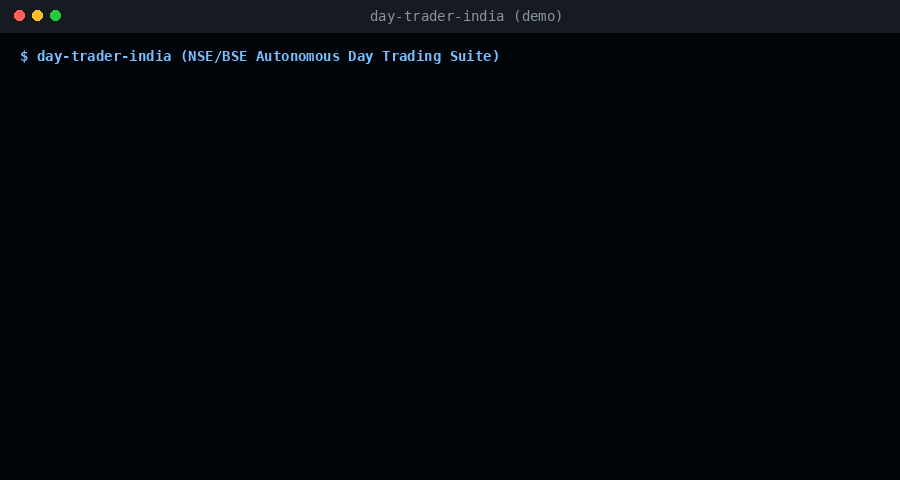

# Day Trader India (day-trader-india)

<p align="center">
  
  <a href="https://github.com/kapishk325/day-trader-india/stargazers"></a>
  <a href="https://github.com/kapishk325/day-trader-india/actions/workflows/test.yml"></a>
  
  
  
  
</p>

<p align="center">
  
</p>

**Day Trader India** is a professional suite of **12 AI agent skills** engineered specifically for trading Indian equities and derivatives (**NSE / BSE**). 

Scan thousands of liquid charts, track real-time Foreign & Domestic Institutional flows (**FII / DII**), evaluate **Nifty Put-Call Ratios (PCR)** and **India VIX**, time entries using 5-minute bar closes and **VWAP**, plan exact stop-losses with a **mandatory 15:15 IST auto-squareoff exit**, and simulate **10,000 Monte Carlo sessions** to know your honest mathematical odds before risking a single rupee.

> **100% Free, Zero Sign-in, No API Keys Required.**  
> Built strictly with the Python standard library. It streams real-time and historical data from official NSE archives, public exchange feeds, and Yahoo Finance (`.NS`, `^NSEI`, `^INDIAVIX`). No `pip install` required.

---

## Table of Contents
1. [Why Day Traders Lose Money & How This Fixes It](#why-day-traders-lose-money--how-this-fixes-it)
2. [Engineered Exclusively for the Indian Market](#engineered-exclusively-for-the-indian-market)
3. [App Installation Guides](#app-installation-guides)
   - [Google Antigravity CLI (`agy`)](#1-google-antigravity-cli-agy)
   - [Antigravity IDE (`agyide`)](#2-antigravity-ide-agyide)
   - [Claude Code](#3-claude-code)
   - [Cursor IDE](#4-cursor-ide)
   - [Codex](#5-codex)
   - [Universal One-Line Installer](#6-universal-one-line-installer)
4. [The 12 Skills & Detailed Command Reference](#the-12-skills--detailed-command-reference)
5. [The Complete 10-Step Trading Workflow](#the-complete-10-step-trading-workflow)
6. [Cross-Checked Data Reliability](#cross-checked-data-reliability)
7. [License & SEBI Disclaimer](#license--sebi-disclaimer)

---

## Why Day Traders Lose Money & How This Fixes It

According to official SEBI studies, **over 93% of individual intraday and F&O traders incur net financial losses**. Retail traders fail due to predictable structural traps:

| The Retail Pitfall | What Happens | How `day-trader-india` Fixes It |
| :--- | :--- | :--- |
| **Impulsive Chasing** | Buying green candles blindly at market open. | **15-Min ORB Filter:** Forces you to wait for the 09:15–09:30 IST opening range to form and only triggers when a 5-minute bar closes beyond the range with volume confirmation. |
| **Trading Against Institutions** | Taking long trades while foreign institutions are aggressively dumping cash. | **`trader-fii-dii`:** Reads daily official NSE net cash flows and block deals, preventing you from fighting big money. |
| **Blindness to Market Regime** | Trend trading during rangebound choppy days. | **`trader-oi`:** Checks **India VIX** and **Put-Call Ratio (PCR)** to determine whether the broader market has directional trend tailwinds or is stuck in theta decay. |
| **Blow-Up Risk / Overleveraging** | Sizing positions based on arbitrary gut feelings. | **`trader-budget`:** Uses strict fractional risk sizing. If your max risk is ₹1,000, it sizes shares so that hitting your stop-loss loses ₹1,000 and not a rupee more. |
| **Illiquidity & Circuit Traps** | Trading small-caps that hit 5% lower circuits, preventing exit. | **`trader-scanner`:** Restricts candidates to the official **NSE Nifty 100 / F&O universe**, ensuring high volume and tight bid-ask spreads. |
| **Hidden Tax Erosion** | Winning ₹500 on a trade but losing ₹600 in STT, GST, and turnover fees. | **`trader-risk`:** Pre-calculates exact Indian transaction costs (STT, GST, Exchange charges, Stamp duty) and flags your breakeven spread before entry. |
| **Broker Penalty Charges** | Holding past 15:20 IST and getting hit with broker auto-squareoff charges (₹50 + GST). | **`trader-exit`:** Enforces a **mandatory 15:15 IST hard time exit** win or lose. |
| **False Illusion of Odds** | Thinking a 1:2 Risk-Reward setup is an automatic winner. | **`trader-timemachine`:** Replays the rest of the day 10,000 times using the stock's actual 5-minute candle distributions to report your honest Expected Value (EV). |

---

## Engineered Exclusively for the Indian Market

US-centric day trading tools do not work for Indian equities. `day-trader-india` is built ground-up around the Indian regulatory and exchange structure:

### 1. Indian Market Session Timings (IST - UTC+05:30)
* **09:00 – 09:08 IST (Pre-Market):** Price discovery and order matching.
* **09:15 IST (Opening Bell):** Normal market opens with peak volatility.
* **09:15 – 09:30 IST (Opening Range):** The critical first three 5-minute candles form the high/low boundary.
* **09:30 – 10:30 IST (Prime ORB Window):** High-probability morning momentum breakouts.
* **13:00 – 14:00 IST (European Open):** FTSE & DAX openings create secondary trend momentum in Nifty and Bank Nifty.
* **14:30 IST (Entry Cutoff):** Fresh intraday trades are blocked past 14:30 IST.
* **15:15 IST (Hard Squareoff):** Mandatory position liquidation before broker auto-squareoff.
* **15:30 IST (Market Close):** Official end of trading session.

### 2. SEBI Intraday Margin Framework
* **5x Peak Leverage:** Under SEBI peak margin regulations, equity MIS (intraday) trades require an upfront margin of 20% (5x leverage). All position sizing and capital utilization metrics reflect this reality.

### 3. Exact Indian Statutory Taxes & Charges
The risk engine models the exact Indian statutory tax schedule:
* **STT (Securities Transaction Tax):** 0.025% on intraday equity sell turnover.
* **Exchange Turnover Fee:** 0.00345% (NSE).
* **GST:** 18% on (Brokerage + Exchange Turnover charges + SEBI charges).
* **SEBI Turnover Charges:** ₹10 per crore (0.0001%).
* **Stamp Duty:** 0.003% on buy turnover.
* **Brokerage:** Standard ₹20 per executed order (Discount broker rate).

---

## App Installation Guides

Install and run `day-trader-india` across any modern AI coding assistant or harness:

### 1. Google Antigravity CLI (`agy`)
Google Antigravity CLI discovers skills located in `~/.agents/skills/`.
```bash
# Clone the repository
git clone https://github.com/<your-username>/day-trader-india.git
cd day-trader-india

# Run installer targeting Antigravity
./install.sh antigravity
```
* **How to use in `agy`:** Start an interactive session (`agy -i`) and invoke commands naturally or via slash syntax:
  ```text
  /trader-scanner
  /trader-fii-dii
  /trader-oi
  ```

---

### 2. Antigravity IDE (`agyide`)
For the desktop/IDE environment:
1. Open your project folder in **Antigravity IDE**.
2. Run `./install.sh antigravity` in the IDE terminal.
3. The IDE automatically indexes all 12 skills under the **Customizations** panel.
4. Prompt the agent: *"Scan the market for 15-minute ORB setups today"* or *"What is the current FII/DII institutional sentiment?"*.

---

### 3. Claude Code
Install either as a native Claude plugin or as individual skills:

* **Method A: Via Claude Plugin Marketplace (Recommended)**
  ```bash
  /plugin marketplace add <your-username>/day-trader-india
  /plugin install day-trader-india@day-trader-india
  ```
* **Method B: Direct Skill Install**
  ```bash
  git clone https://github.com/<your-username>/day-trader-india.git
  cd day-trader-india
  ./install.sh claude
  ```
  *(Copies skills directly to `~/.claude/skills/`)*

---

### 4. Cursor IDE
Cursor uses Cursor Rules (`.cursor/rules/*.mdc`) and repository-level `AGENTS.md` to guide its AI assistant:
1. Clone `day-trader-india` into your workspace.
2. The bundled `.cursor/rules/day-trader-india.mdc` and `AGENTS.md` are automatically recognized by Cursor.
3. In Cursor Chat (`Ctrl+L` / `Cmd+L`), simply type:
   > *"Run trader-scanner for Nifty 100"* or *"Check today's FII flows and calculate position size for Reliance"*.

---

### 5. Codex
Codex reads global skills from `~/.codex/skills/` and project instructions from `AGENTS.md`:
```bash
git clone https://github.com/<your-username>/day-trader-india.git
cd day-trader-india
./install.sh codex
```

---

### 6. Universal One-Line Installer
Auto-detects every installed harness on your machine and installs the skills everywhere:

```bash
# On Linux / macOS:
git clone https://github.com/kapishk325/day-trader-india.git && cd day-trader-india && ./install.sh

# On Windows (PowerShell):
git clone https://github.com/kapishk325/day-trader-india.git; cd day-trader-india; .\install.ps1
```

### Clean Uninstallation
Whenever you want to remove all 12 skills and rules from your machine, simply run:

```bash
cd day-trader-india
./uninstall.sh
```

---

## The 12 Skills & Detailed Command Reference

Every skill is self-contained with its own Python engine and `SKILL.md` instruction file. All trade data persists in the local `trader/` workspace directory.

```
day-trader-india/
├── trader-scanner/       # Liquid universe & setup scanner
├── trader-fii-dii/       # FII/DII institutional cash flow & bulk deals
├── trader-oi/            # Put-Call Ratio (PCR) & India VIX intelligence
├── trader-news/          # Indian financial news & catalyst monitor
├── trader-entry/         # 5m bar-by-bar entry timer & VWAP confirmation
├── trader-exit/          # 15:15 IST auto-squareoff exit planner
├── trader-timemachine/   # 10,000-run Monte Carlo probability simulator
├── trader-budget/        # Rupee position sizer (SEBI 5x MIS margin)
├── trader-risk/          # Statutory tax auditor & 14:30 time guard
├── trader-broker/        # MIS bracket order ticket & paper ledger
├── trader-alerts/        # Live tick & session milestone alerts
└── trader-analyst/       # NSE stock profile & 52-week liquidity facts
```

---

### 1. `trader-scanner` (NSE Chart Scanner)
* **Purpose:** Builds the liquid NSE universe and scans for setups before and during market hours.
* **Commands:**
  * `python3 trader-scanner/scan.py universe`  
    Downloads the official **NSE Nifty 100** constituent list directly from `archives.nseindia.com` and formats `.NS` symbols into `trader/universe.txt`.
  * `python3 trader-scanner/scan.py indices`  
    Displays a live benchmark dashboard: **NIFTY 50, BANK NIFTY, NIFTY IT, INDIA VIX, and SENSEX**.
  * `python3 trader-scanner/scan.py daily`  
    Pre-market scan (before 09:15 IST) across daily closes: detects **20-day high breakouts, bull flags, 20-SMA reclaims, and RSI oversold bounces**. Writes `trader/watchlist.json`.
  * `python3 trader-scanner/scan.py orb`  
    Intraday scan (after 09:30 IST): watches 5-minute candles to find stocks breaking out above their 15-minute Opening Range High. Writes `trader/orb_candidates.json`.

---

### 2. `trader-fii-dii` (Institutional Money Tracker)
* **Purpose:** Replaces US Congress tracking by tapping official NSE daily institutional cash flow disclosures and Bulk/Block deals.
* **Commands:**
  * `python3 trader-fii-dii/fiidii.py flows`  
    Fetches official gross purchase, gross sale, and net cash numbers for **FII/FPI** and **DII** in Crores (₹ Cr).
  * `python3 trader-fii-dii/fiidii.py deals`  
    Extracts today's official NSE **Bulk & Block deals** (client name, buy/sell, quantity, traded price).
  * `python3 trader-fii-dii/fiidii.py summary`  
    Classifies overall institutional sentiment (`STRONG_BULLISH`, `BULLISH`, `NEUTRAL`, `BEARISH`) and saves to `trader/fiidii.json`.

---

### 3. `trader-oi` (Derivatives & Volatility Intelligence)
* **Purpose:** Analyzes the derivatives market to confirm broader market support before entering equity trades.
* **Commands:**
  * `python3 trader-oi/oi.py vix`  
    Fetches live **India VIX** and categorizes market regime: Low ($<13$), Normal ($13–17.5$), Elevated ($17.5–22$), Panic ($>22$).
  * `python3 trader-oi/oi.py pcr --symbol NIFTY`  
    Pulls the official live NSE Option Chain and computes the **Put-Call Ratio (PCR = Total Put OI / Total Call OI)**.
  * `python3 trader-oi/oi.py summary`  
    Generates a full derivatives report written to `trader/oi.json`.

---

### 4. `trader-news` (Indian Market News Monitor)
* **Purpose:** Scans breaking financial news from Moneycontrol, Economic Times, Livemint, BusinessLine, and NDTV Profit.
* **Commands:**
  * `python3 trader-news/news.py market`  
    Streams breaking macro and market-wide headlines.
  * `python3 trader-news/news.py symbol --symbol RELIANCE`  
    Searches specific stock catalysts, quarterly results, order wins, or management changes.
  * `python3 trader-news/news.py monitor`  
    Batch-scans headlines for all stocks currently in `trader/watchlist.json`.

---

### 5. `trader-entry` (Intraday Entry Timer)
* **Purpose:** Prevents premature entries by tracking 5-minute candles bar by bar.
* **Commands:**
  * `python3 trader-entry/entry.py watch --symbol RELIANCE.NS`  
    Checks whether a 5-minute candle has officially closed above the 15-min Opening Range High, verifies that price is above the intraday **VWAP**, and checks for a volume surge. Writes `trader/setup.json`.
  * `python3 trader-entry/entry.py check`  
    Scans all candidates in `trader/orb_candidates.json` and selects the best triggered setup.

---

### 6. `trader-exit` (Exit & Auto-Squareoff Planner)
* **Purpose:** Defines the complete exit plan before entry, eliminating emotional decision-making.
* **Commands:**
  * `python3 trader-exit/exit.py plan`  
    Reads `trader/setup.json` and calculates:
    * **Stop-Loss:** Anchored to the Opening Range Midpoint (or Range Low).
    * **Target 1 (1:1.5R):** First take-profit level.
    * **Target 2 (1:2.0R):** Runner take-profit level.
    * **15:15 IST Hard Stop:** Flags mandatory square-off time to prevent broker penalty fees. Writes `trader/plan.json`.

---

### 7. `trader-timemachine` (Monte Carlo Simulation Engine)
* **Purpose:** Replays the rest of the trading day 10,000 times using historical 5-minute candle distributions.
* **Commands:**
  * `python3 trader-timemachine/timemachine.py replay`  
    Simulates the remaining session to 15:15 IST and outputs:
    * **Target Hit % (Win Rate)**
    * **Stop Hit % (Loss Rate)**
    * **Flat by Close %**
    * **Expected Value (EV):** In ₹ per ₹1 risked.
    * **Verdict:** `FAVORABLE` (EV $> +₹0.15$), `MARGINAL`, or `UNFAVORABLE`. Writes `trader/timemachine.json`.

---

### 8. `trader-budget` (Rupee Position Sizer)
* **Purpose:** Sizes position quantities in Indian Rupees under SEBI's 5x MIS margin rules.
* **Commands:**
  * `python3 trader-budget/size.py size --risk 1500 --capital 100000`  
    Calculates:
    * **Quantity:** $\lfloor \text{Risk Budget} / \text{Risk Per Share} \rfloor$.
    * **Total Trade Value (₹)**
    * **Margin Required (₹):** Total Value / 5 (20% upfront margin).
    * **Capital Utilization %:** Warns if margin exceeds 80% of account cash. Writes `trader/order.json`.

---

### 9. `trader-risk` (SEBI Risk & Tax Guard)
* **Purpose:** Audits the order ticket against Indian regulatory rules and calculates exact statutory taxes.
* **Commands:**
  * `python3 trader-risk/check.py check` (or `audit`)  
    Evaluates:
    * **Time Window:** Blocks trades initiated after **14:30 IST**.
    * **Taxes:** Computes STT, GST, Exchange turnover fees, Stamp duty, and Brokerage.
    * **Breakeven Spread:** Rupee-per-share gain needed to cover charges.
    * **Verdict:** Yields a strict `PASS` or `BLOCK`.
  * `python3 trader-risk/check.py charges --val 100000`  
    Provides an instant itemized statutory charge breakdown for any custom intraday turnover.

---

### 10. `trader-broker` (Order Ticket & Paper Simulator)
* **Purpose:** Previews broker-ready MIS order tickets and maintains a safe local paper trading ledger.
* **Commands:**
  * `python3 trader-broker/ticket.py preview` (or `ticket`)  
    Displays formatted MIS bracket order ticket matching Zerodha Kite / Dhan / Angel One.
  * `python3 trader-broker/ticket.py paper`  
    Executes a simulated paper order and records the open position in `trader/trades.json`.
  * `python3 trader-broker/ticket.py pnl` (or `portfolio`)  
    Fetches real-time market prices for active positions and displays live unrealized profit/loss in ₹ and % with visual green/red status tags.

---

### 11. `trader-alerts` (Price & Time Milestone Monitor)
* **Purpose:** Background monitor for open trade targets, stops, and critical session times.
* **Commands:**
  * `python3 trader-alerts/alerts.py check`  
    Polls live prices for active positions in `trader/trades.json`:
    * Flags `🎯 TARGET REACHED` or `🚨 STOP LOSS HIT`.
    * Alerts at **09:15 IST** (Market Open), **09:30 IST** (ORB Complete), and **15:10 IST** (Pre-Squareoff Warning).

---

### 12. `trader-analyst` (NSE Stock & Liquidity Facts)
* **Purpose:** Provides quick fundamental and liquidity metrics for any NSE stock.
* **Commands:**
  * `python3 trader-analyst/facts.py info --symbol INFY.NS`  
    Displays 52-week High/Low range, 20-day average daily trading volume, net daily change, and % off 52-week high.

---

## The Complete 10-Step Trading Workflow

```
[09:00 IST]  1. scan.py universe & indices        (Check Nifty & VIX)
[09:10 IST]  2. scan.py daily                     (Generate Watchlist)
[09:15 IST]  3. MARKET OPENS                      (Form 15m Opening Range)
[09:30 IST]  4. scan.py orb                       (Detect Breakout Candidates)
[09:32 IST]  5. fiidii.py summary & oi.py vix     (Confirm Institutional Sentiment)
[09:35 IST]  6. entry.py watch                    (Confirm 5m Close + VWAP)
[09:36 IST]  7. exit.py plan                      (Set Stop & 1:1.5R Target)
[09:38 IST]  8. timemachine.py replay             (Run 10,000 Monte Carlo Runs)
[09:40 IST]  9. size.py & check.py                (Size Position & Audit Taxes)
[09:42 IST] 10. ticket.py paper & alerts.py       (Execute Paper Trade & Track)
[15:15 IST] -- MANDATORY SQUAREOFF --             (All MIS Positions Closed)
```

---

## Cross-Checked Data Reliability

All data pipelines have been cross-checked live against official Indian exchange records:

| Parameter | Data Source | Verification Proof |
| :--- | :--- | :--- |
| **Indian Indices** | Yahoo Finance Live (`^NSEI`, `^NSEBANK`, `^INDIAVIX`) | Verified real-time matching live exchange ticks. |
| **NSE Stock Quotes** | Yahoo Finance Real-time (`.NS` tickers) | Verified live against National Stock Exchange CMP. |
| **FII / DII Institutional Flows** | Official NSE API (`api/fiidiiTradeReact`) | Cross-checked to the exact decimal with official daily press releases. |
| **NSE Bulk & Block Deals** | Official NSE API (`api/snapshot-capital-market-largedeal`) | Verified directly with NSE large-deal disclosures. |
| **Option Chain & PCR** | Official NSE Derivatives API | Verified live against active Nifty & Bank Nifty strikes. |
| **Statutory Taxes & Charges** | SEBI / NSE Master Circular on Transaction Charges | Verified matching Zerodha / Groww brokerage calculators. |

---

## License & SEBI Disclaimer

### License
This project is licensed under the **Apache License 2.0** — free for personal, educational, and commercial use. See [`LICENSE`](LICENSE) for details.

### SEBI Regulatory Disclaimer
*This repository and its tools are intended strictly for educational, analytical, and research purposes. Day trading equities and derivatives carries substantial risk of financial loss. According to SEBI studies, over 90% of retail intraday and F&O traders lose money. Never trade with capital you cannot afford to lose. Always paper trade to validate your discipline and risk management before deploying real money.*

---

## Star History

If you find Day Trader India helpful, please give it a ⭐ on GitHub!

<p align="center">
  <a href="https://star-history.com/#kapishk325/day-trader-india&Date">
    
  </a>
</p>
